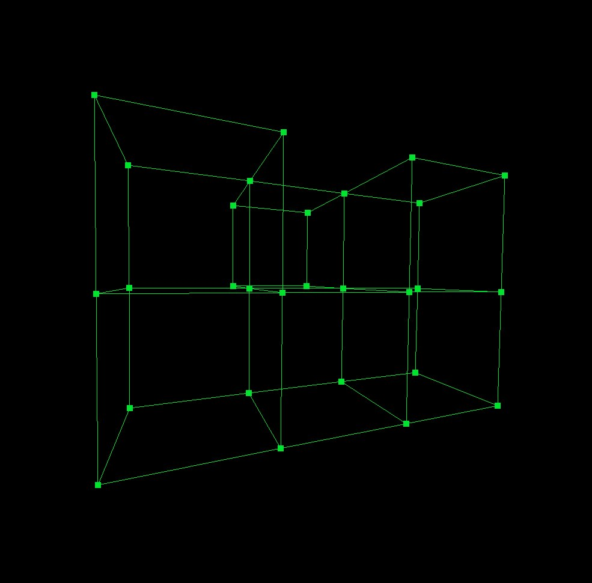

# Table of Contents

1.  [Features](#orgdc8017a)
2.  [Requirements](#orgeff18b6)
3.  [Instalation](#org3455b98)
4.  [Usage](#orga080528)
    1.  [Build](#org323a188)
    2.  [Run](#org73b88b2):ATTACH:
5.  [Screenshots](#org9851c61)
6.  

# Features

-   Drawing cubes (more objects in the future)
-   Moving in the world
-   Camera rotating

# Requirements

-   C++17
-   CMake 3.20+
-   [raylib](https://www.raylib.com/) 5.5 or newer

# Instalation

    git clone https://github.com/DaniilRoitenberg688/small_3d_engine.git
    cd small_3d_engine/

# Usage

## Build

    make configure
    make build

## Run     :ATTACH:

    make run

# Screenshots

# TODO 

-   More objects
-   Advanced faces drawing
-   Light
-   Physics

