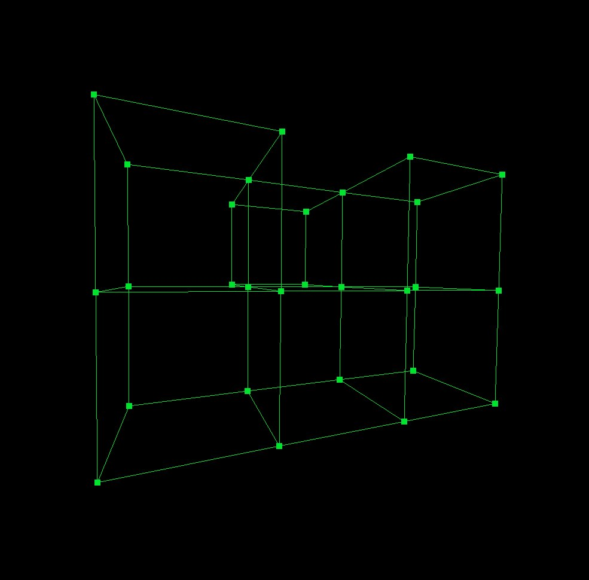

#+title: Tiny 3D engine
#+description: Tiny 3D engine build in c++ for exploring 3d rendering.

* Features
- Drawing cubes (more objects in the future)
- Moving in the world
- Camera rotating

* Requirements
- C++17
- CMake 3.20+
- [[https://www.raylib.com/][raylib]] 5.5 or newer

* Instalation

#+begin_src bash
git clone https://github.com/DaniilRoitenberg688/small_3d_engine.git
cd small_3d_engine/
#+end_src

* Usage
** Build
#+begin_src bash
make configure
make build
#+end_src
** Run :ATTACH:
:PROPERTIES:
:ID:       13471f47-6c02-48e1-bfbc-550f8e5e80ba
:END:
#+begin_src bash
make run
#+end_src

* Screenshots
#+caption: screenshot

* TODO
- More objects
- Advanced faces drawing
- Light
- Physics
